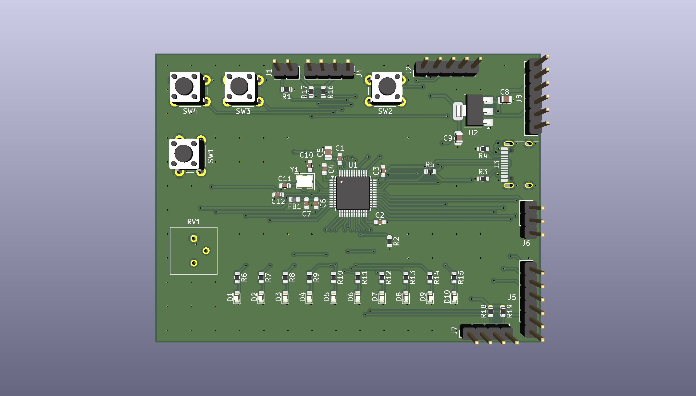

# EcoCar Onboarding PCB (STM32F103)

My onboarding board for the EcoCar team (Electrical), 2026–27 season. It's an STM32F103C8T6 development board powered and programmed over USB-C/SWD, with 10 LEDs, buttons, a potentiometer and headers for I2C, SPI and UART.

**Status:** design finished and checked (ERC 0, DRC 0, schematic/PCB parity 0). Waiting for the Electrical Lead's review before ordering. Assembly and firmware come next.

## What's on the board

| Block | Parts | Notes |
|---|---|---|
| MCU | U1 STM32F103C8T6 (LQFP-48) | 8 MHz crystal Y1 with 20 pF load caps (C10, C11) |
| Power | J3 USB-C, U2 AMS1117-3.3 | 5 V from USB → 3.3 V. C8 10 µF in, C9 22 µF out |
| Decoupling | C1–C4 100 nF, C5 4.7 µF | One 100 nF right next to each VDD/VBAT pin |
| Analog supply | FB1 ferrite bead, C6 10 nF, C7 1 µF | Filters 3.3 V into VDDA |
| USB | R3, R4 5.1 kΩ on CC1/CC2, R5 1.5 kΩ D+ pull-up | USB full speed on PA11/PA12 |
| Programming | J2 SWD header, SW1 reset, J1 BOOT0 jumper | R1/R2 10 kΩ pull-downs on BOOT0/BOOT1 |
| LEDs | D1–D10 (4 red, 3 yellow, 3 green), 330 Ω each | D6–D10 are on timer channels for PWM |
| Inputs | SW2–SW4 push buttons, RV1 10 kΩ potentiometer | Buttons use internal pull-ups; pot goes to ADC PA0 |
| Headers | J4 OLED (I2C1), J5 SPI2, J6 UART1, J7 I2C2, J8 power | 4.7 kΩ pull-ups on both I2C buses (R16–R19) |

## Pin map

| MCU pin | Function | Connected to |
|---|---|---|
| PA0 | ADC1_IN0 | RV1 wiper |
| PA1–PA5 | GPIO out | LED1–LED5 (D1–D5) |
| PA6, PA7, PB0, PB1, PA8 | TIM PWM | LED_PWM1–5 (D6–D10) |
| PA9 / PA10 | USART1 TX / RX | J6 |
| PA11 / PA12 | USB D− / D+ | J3 |
| PA13 / PA14 | SWDIO / SWCLK | J2 |
| PB5, PB8, PB9 | GPIO in | BTN1–BTN3 (SW2–SW4) |
| PB6 / PB7 | I2C1 SCL / SDA | J4 (OLED) |
| PB10 / PB11 | I2C2 SCL / SDA | J7 |
| PB12–PB15 | SPI2 CS / SCK / MISO / MOSI | J5 |
| PD0 / PD1 | HSE in / out | Y1 8 MHz |

## Header pinouts (pin 1 first)

- **J2 SWD:** 3V3, SWCLK, SWDIO, NRST, GND
- **J4 OLED:** GND, 3V3, SCL, SDA
- **J5 SPI2:** GND, 3V3, SCK, MISO, MOSI, CS
- **J6 UART1:** GND, TX, RX
- **J7 I2C2:** GND, 3V3, SCL, SDA
- **J8 Power:** 5V, 5V, 3V3, 3V3, GND, GND
- **J1 BOOT0:** BOOT0, 3V3 (jumper on = boot from system memory)

## Layout

- 80 × 60 mm, 2 layers, 1.6 mm FR4
- Ground pour on both layers, stitched with vias across the board
- Top layer routes horizontally, bottom layer vertically, with vias to change direction (short fan-outs at the pins)
- Signal traces 0.25 mm, 3.3 V 0.4 mm, 5 V 0.5 mm, 0.2 mm clearance
- 0603 or larger passives, no BGA
- The USB-C connector's mouth sits flush with the right edge. Its silkscreen line was trimmed so it doesn't hang off the board, which is why there's one DRC exclusion (library mismatch on J3).

## Files

- `hardware/ecocar_onboarding/` — KiCad 10 project (schematic, PCB, schematic PDF)
- `firmware/ecocar_onboarding.ioc` — STM32CubeMX pin configuration
- `docs/board_3d.png` — 3D render

## How it was made

Following the Phil's Lab KiCad STM32 tutorial and the EcoCar onboarding requirements.

## Next steps

1. Design review with the Electrical Lead
2. Order the board and solder it by hand
3. Firmware in STM32CubeIDE: LED patterns, potentiometer → PWM brightness, buttons, USB serial messages, OLED
